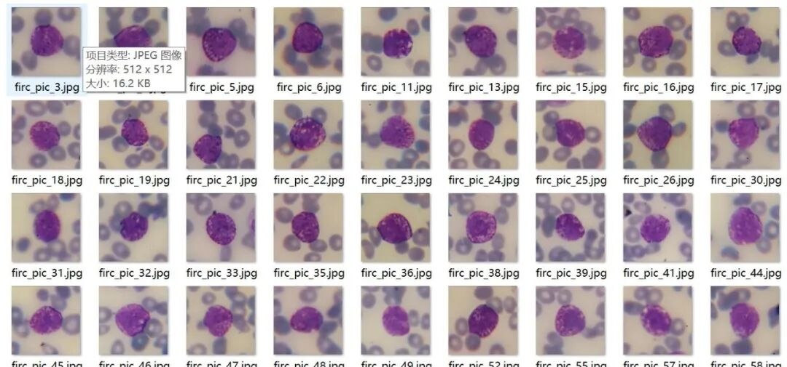
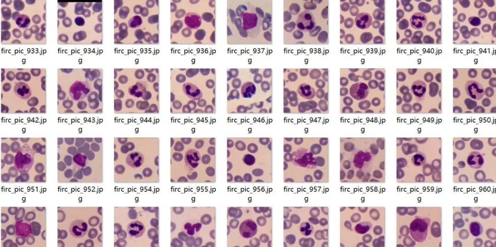
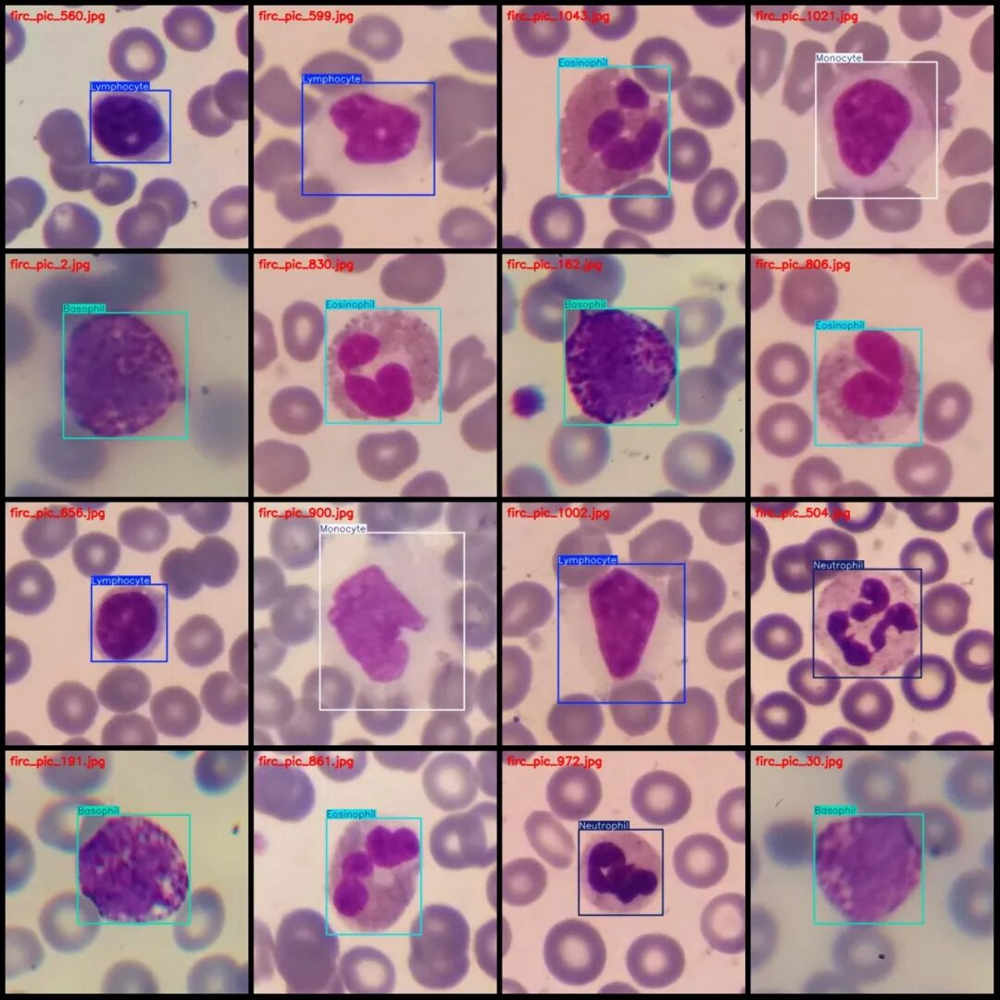
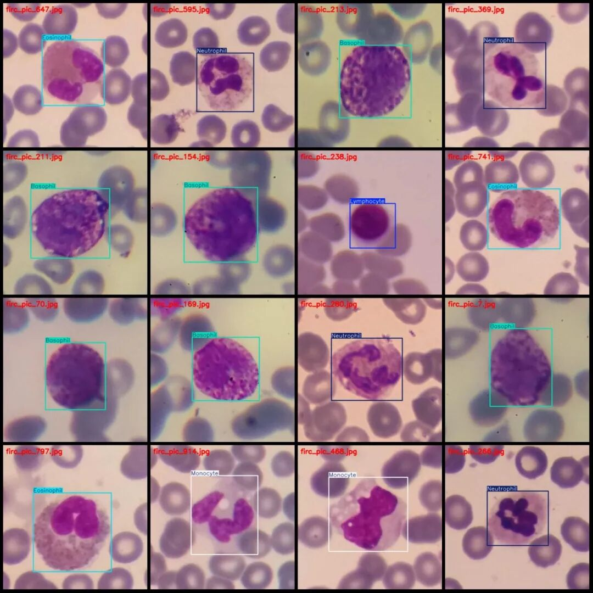
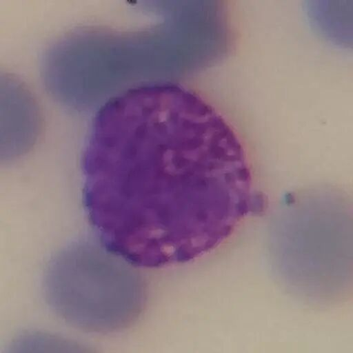
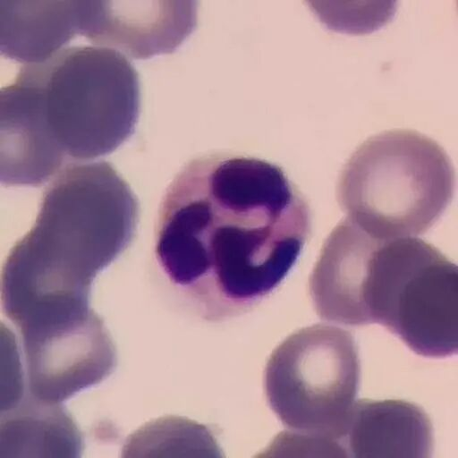
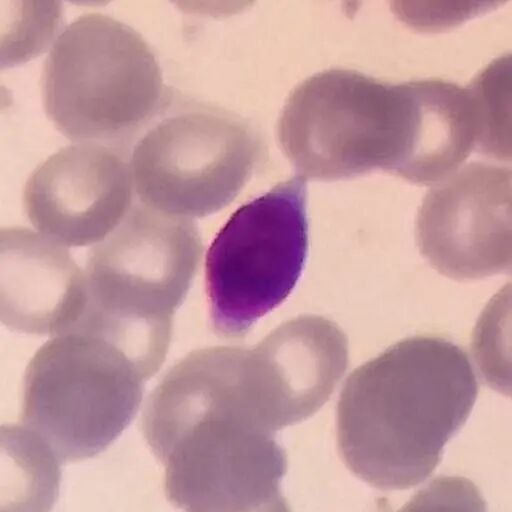

# VOC+YOLO format, 1145 images of five different white blood cell micrographs

Dataset format: Pascal VOC format + YOLO format (txt file without split path, only containing jpg images and corresponding VOC format xml files and yolo format txt files)

Number of images (number of jpg files): 1145

Number of annotations (number of xml files): 1145

Number of annotations (number of txt files): 1145

Label category count: 5

Label category names (note that the order of yolo format categories does not correspond to this, but is based on the labels folder's classes.txt): ["Basophil", "Eosinophil", "Lymphocyte", "Monocyte", "Neutrophil"]

Number of boxes and the number of images occupied by each category:

Basophil (Eosinophil) frame count = 218, occupying picture count = 218

Eosinophil (Eosinophil) frame count = 203, occupying picture count = 201

Lymphocyte (lymphocyte) frame count = 242, occupying picture count = 242

Monocyte (monocytes) frame count = 243, occupying picture count = 242

Neutrophil (neutrophils) frame count = 242, occupying picture count = 242

Total frame count: 1148

Image resolution: 512x512

Using labelImg:

Annotation rules: Draw a rectangle around the category.

Important Notice: The dataset does not have separate training, validation, and test sets; you need to partition them yourself.

Special : This dataset does not guarantee the accuracy of the trained models or weight files.

Image Preview:

Annotation example:

Single image:

## Payment

Here is a pay link on Stripe ( https://buy.stripe.com/3cs8yP7sY87d0vu9AB ). Please contact me lonlonago@foxmail.com after funding $89, and I will send you a complete data files , thank you!

